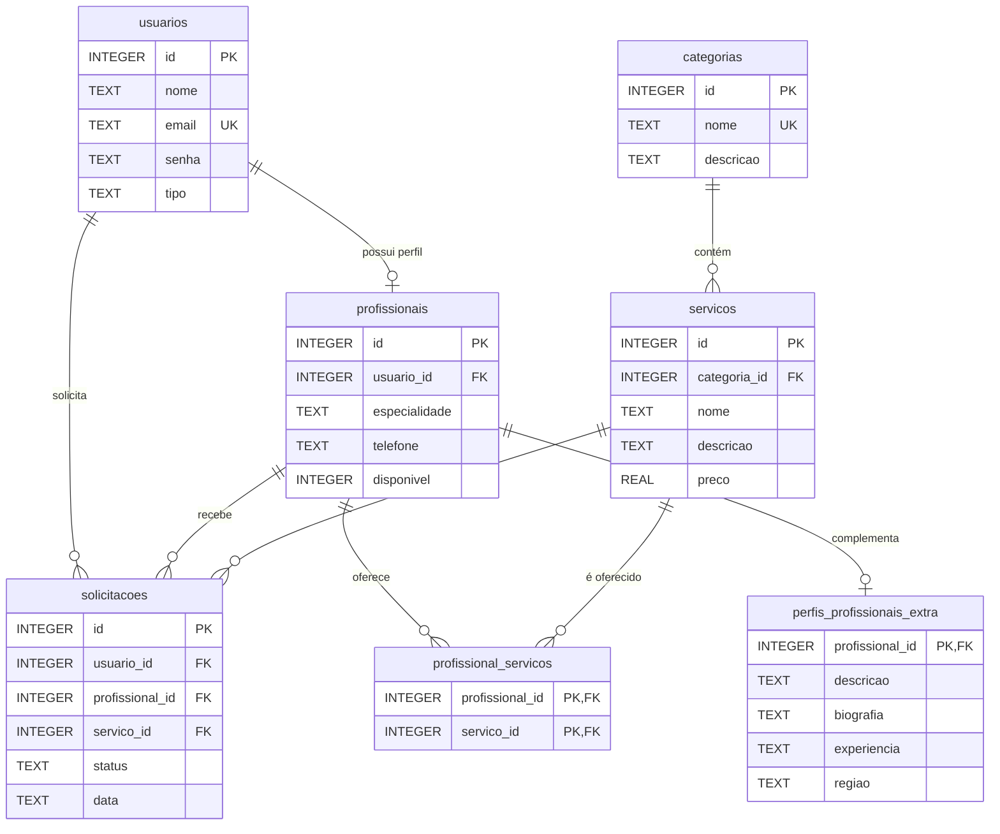

# DER lógico atualizado — Reparaê

O banco de demonstração possui **sete tabelas de domínio**: `usuarios`, `profissionais`, `categorias`, `servicos`, `solicitacoes`, `profissional_servicos` e `perfis_profissionais_extra` (além da tabela interna `sqlite_sequence`).

## Regras principais

- `usuarios.tipo` aceita `cliente`, `profissional` e `admin`.
- `profissionais.usuario_id` é único: cada usuário profissional possui no máximo um perfil.
- `profissional_servicos` permite vincular muitos serviços a muitos profissionais, com chave primária composta.
- `solicitacoes` referencia cliente, profissional e serviço. A API valida que o profissional oferece o serviço solicitado.
- `solicitacoes.status` aceita `Pendente`, `Aceita`, `Recusada`, `Concluída` e `Cancelada`.
- A integridade referencial do SQLite é habilitada em cada conexão pelo `database.py`.

**Nota:** Este DER em Mermaid descreve a estrutura verificada no banco do ZIP; os PNGs antigos foram preservados como histórico e não foram regenerados.
